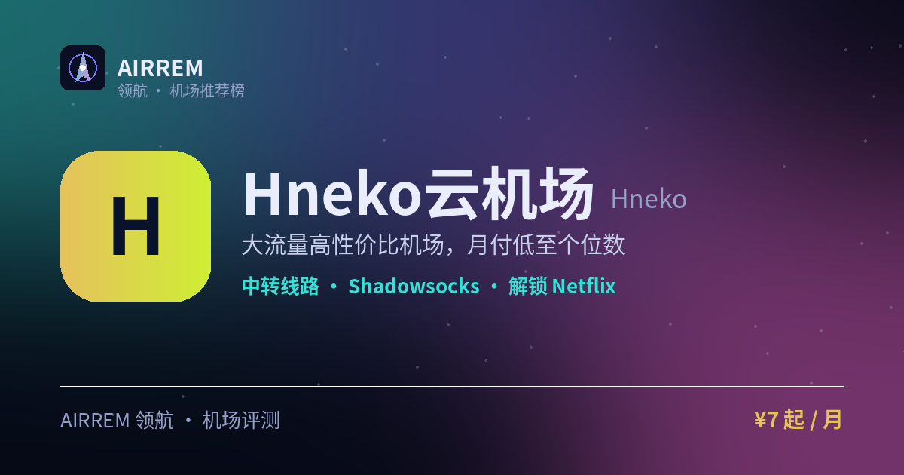

# Hneko云机场评测 2026：大流量党，官网注册入口与套餐价格

> 大流量高性价比机场，月付低至个位数
>
> 最适合：**大流量党**。

👉 **[Hneko云机场 官网注册入口](https://s.rtxk.us/s/bvaumhm)** ｜ [完整评测与横向对比](https://555736.xyz/hneko/)

---

## 基本信息

| 项目 | 内容 |
| --- | --- |
| 机场名称 | Hneko云机场 |
| 成立时间 |  |
| 线路类型 | 公网隧道中转 |
| 支持协议 | Shadowsocks / Trojan / VMess |
| 流媒体解锁 | Netflix / ChatGPT |
| 节点地区 | 香港 · 日本 · 美国 等 |
| 计费方式 | 包月 / 包年 / 不限时 |
| 起步价格 | ¥7 / 月 |
| 推荐场景 | 想要大流量高性价比、主备兼顾 |

## 优点与缺点

**✅ 优点**

- 大流量套餐价格低、性价比高
- 套餐形式多样
- 适合主力+备用组合

**⚠️ 缺点**

- 据反馈节点稳定性有波动，高峰偶有卡顿
- 低价机场可能限速/超售
- 机场行业存在跑路风险，建议先用月付或小额套餐验证稳定性，别一上来就大额年付。

## Hneko 云机场是什么

Hneko 云机场主打大流量、高性价比，套餐形式多样（月付/年付/不限时流量包），价格在同类机场中偏低。

## 线路 · 协议 · 解锁

公网隧道中转，覆盖港日美等常见地区，官方定位「国际节点标准」，价格是主要卖点；支持 SS/Trojan/VMess，可满足 Netflix、ChatGPT 等日常访问。

- 公网隧道中转
- 协议：SS / Trojan / VMess

> 💡 据反馈高峰或特定时段偶有不稳定，需不定期更新订阅链接。

## Hneko云机场 套餐价格

| 套餐 | 价格 | 说明 |
| --- | --- | --- |
| 月付 | ¥7 | 约 700GB/月 |
| 年付 | ¥15 | 约 700GB/月 |
| 不限时 | ¥25 | 1TB 用完为止 |

> 不同来源流量数字略有出入、域名曾变更，以官网为准。

## 常见问题

**Q：值得买吗？**

A：性价比高、适合主备兼用，但稳定性有波动，建议先月付测试。

**Q：要常更新订阅吗？**

A：部分用户反馈节点会调整，建议关注官方群并按需更新订阅。

## 适合谁 / 不适合谁

| 👍 适合 | 👎 不适合 |
| --- | --- |
| 需要大流量、预算有限 | 对稳定性要求极高、无法容忍波动的用户 |
| 已有主力、想找高性价比备用 |  |

## 我们的结论

以大流量、低价著称，套餐含月付/年付/不限时多种；据用户反馈节点稳定性时有波动、需留意订阅更新，建议先月付验证。

## 同类机场推荐

拿不定主意？可以再看看这几家同类型的：

- **[守候](https://555736.xyz/shouhou/)** — 稳健老用户 / Emby 影音，¥15 起
- **[自由猫](https://555736.xyz/freecat/)** — 日常主力，¥6 起
- **[淘气兔](https://555736.xyz/taoqitu/)** — 联通移动用户，¥7.8 起

全部 38 家机场的横向对比与选购方法论：**[信号塔 SignalTower · 机场大全](https://555736.xyz/airports/)**

---

数据更新：2026-07 ｜ 价格、套餐与优惠码以官网实时为准 ｜ 本仓库为第三方评测整理，与 Hneko云机场 官方无隶属关系 ｜ 请遵守当地法律法规使用网络服务。

关键词：Hneko云机场、hneko、大流量机场、低价机场、机场推荐
